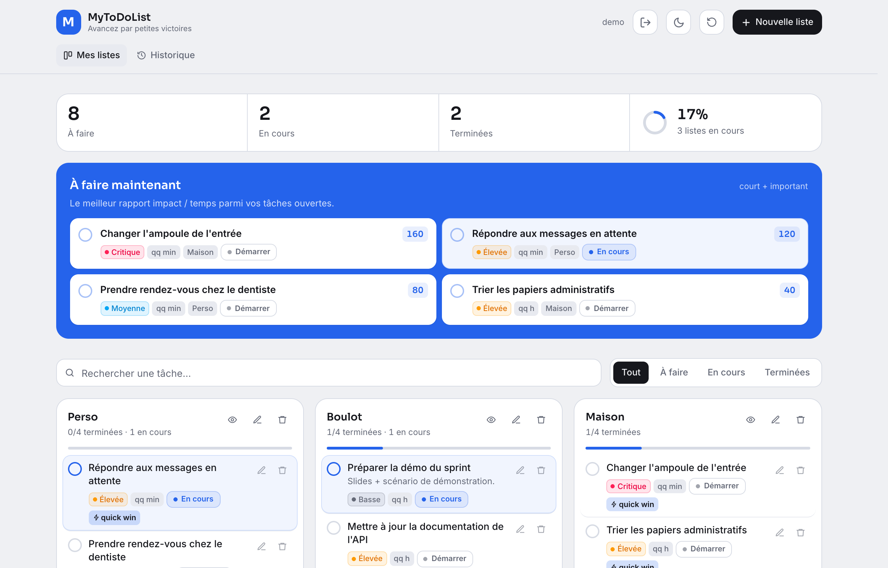
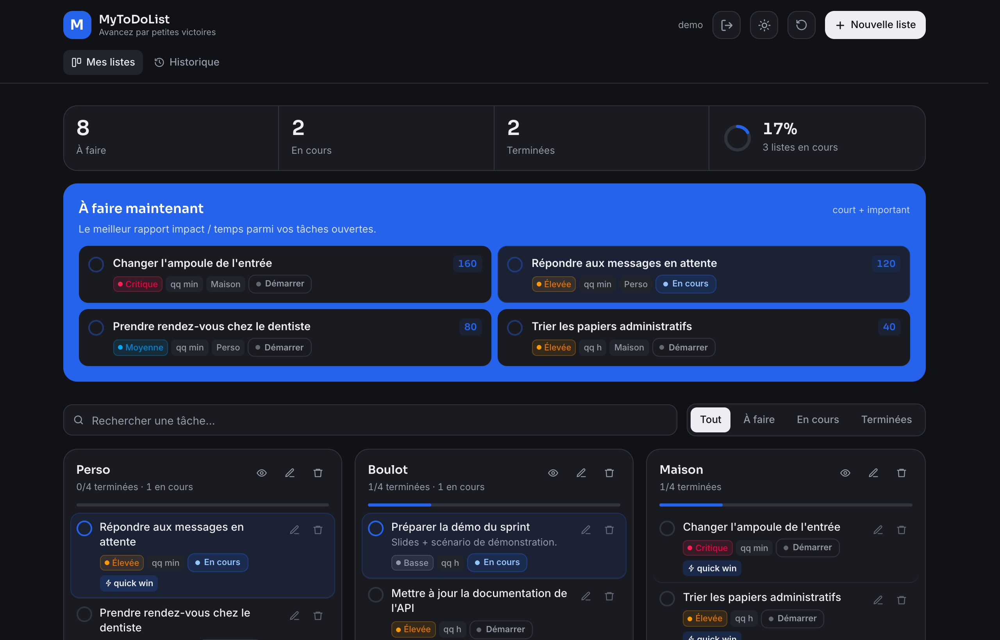
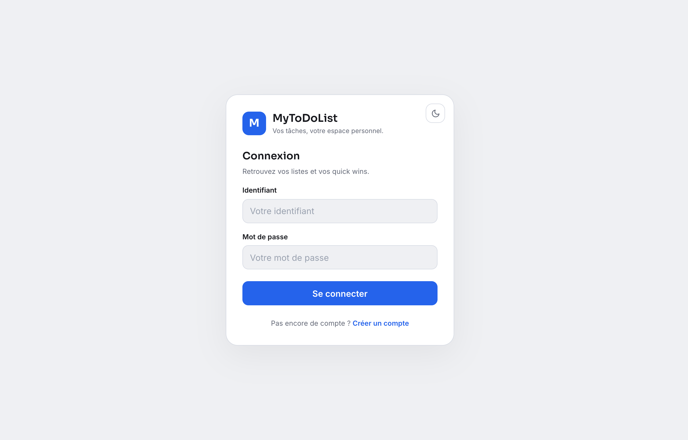

<div align="center">


# MyToDoList

**La todo list qui simplifie votre quotidien : avancez par petites victoires.**

Listes, quick wins, suivi « en cours » et historique, avec une API REST et une base SQLite auto-hébergée.


[Quickstart](#-quickstart) · [Fonctionnalités](#-fonctionnalités) · [API REST](#-api-rest) · [Sécurité](#-sécurité) · [Structure](#-structure-du-projet) · [Contribuer](#-contribuer)

</div>

---



<table>
  <tr>
    <td width="50%"></td>
    <td width="50%"></td>
  </tr>
  <tr>
    <td align="center"><sub>Thème sombre</sub></td>
    <td align="center"><sub>Écran de connexion</sub></td>
  </tr>
</table>

## ✨ Fonctionnalités

- **À faire maintenant** : les tâches au meilleur rapport impact / temps sont mises en avant automatiquement (« court + important »).
- **Quick wins** : repérage des tâches rapides et importantes.
- **Statuts** *À faire*, *En cours* et *Terminée*, avec un bouton « Démarrer » sur chaque tâche.
- **Criticité** (basse → critique) et **durée estimée** (quelques minutes → un mois) pour chaque tâche.
- **Onglets** : regroupez vos listes par thème (« Mes listes boulot », « Mes listes perso »…). Créez, renommez (double-clic sur l'onglet), réordonnez et supprimez vos onglets ; celui le plus à gauche s'affiche à l'ouverture.
- **Listes multiples** : progression par liste, archivage, masquage par appareil, déplacement d'un onglet à l'autre. Les longues listes défilent dans leur carte au lieu d'allonger la page.
- **Déplacement des tâches** par glisser-déposer, au sein d'une liste ou vers une autre : à la souris en attrapant la tâche, au doigt par sa poignée, au clavier avec les flèches sur la poignée. Maintenir la tâche sur un onglet l'ouvre, pour la déposer dans l'une de ses listes. Une liste réordonnée à la main conserve cet ordre (tâches terminées en bas) ; un bouton de la carte rétablit le tri automatique.
- **Recherche** et filtres par statut.
- **Historique** des tâches terminées.
- **Thèmes clair et sombre**, mémorisés par appareil (préférence du système à la première visite).
- **Comptes utilisateurs** : chaque compte a ses propres listes et tâches.
- **Auto-hébergé** : aucune dépendance à un CDN ni à un service tiers, polices comprises.

## 🧰 Technologies

| Couche | Technologies |
|---|---|
| Serveur | [Node.js 24+](https://nodejs.org/), [Express 5](https://expressjs.com/), [helmet](https://helmetjs.github.io/), [express-rate-limit](https://github.com/express-rate-limit/express-rate-limit) |
| Base de données | SQLite via le module natif [`node:sqlite`](https://nodejs.org/api/sqlite.html), sans module natif à compiler |
| Interface | HTML, JavaScript (modules ES, sans framework), [Tailwind CSS v4](https://tailwindcss.com/) |
| Polices | [Inter](https://rsms.me/inter/) et [Sora](https://fonts.google.com/specimen/Sora), auto-hébergées via [Fontsource](https://fontsource.org/) |
| Tests | Test runner natif de Node.js (`node --test`), [jsdom](https://github.com/jsdom/jsdom) pour les tests d'interface |

## 🚀 Quickstart

**Prérequis :** Node.js **24 ou supérieur** et npm.

```bash
# 1. Installer les dépendances
npm install

# 2. Générer les polices et le CSS
npm run build

# 3. Lancer le serveur
npm start
```

Ouvrir **<http://localhost:3000>**, puis cliquer sur **Créer un compte** (mot de passe de 12 caractères minimum).

La base SQLite est créée automatiquement dans `data/mytodolist.sqlite`.

### Développement

```bash
npm run dev        # serveur rechargé à chaque modification
npm run watch:css  # dans un second terminal : CSS régénéré en continu
npm test           # tests d'intégration et unitaires
```

### Scripts npm

| Commande | Rôle |
|---|---|
| `npm start` | Démarre le serveur |
| `npm run dev` | Démarre le serveur en mode rechargement automatique |
| `npm test` | Lance les tests |
| `npm run test:coverage` | Lance les tests et génère le rapport de couverture de `src/` et `public/js/` dans `coverage/lcov.info` (lu par SonarQube Cloud) |
| `npm run build` | Copie les polices puis génère le CSS minifié |
| `npm run build:css` | Génère uniquement `public/css/main.css` à partir de `styles/main.css` |
| `npm run watch:css` | Régénère le CSS à chaque modification |
| `npm run build:fonts` | Copie les polices `.woff2` dans `public/fonts/` |

> [!NOTE]
> `public/css/main.css` est généré par la CLI Tailwind : modifier `styles/main.css`, jamais le fichier généré.

## ⚙️ Configuration

| Variable | Défaut | Description |
|---|---|---|
| `PORT` | `3000` | Port HTTP du serveur |
| `DB_PATH` | `data/mytodolist.sqlite` | Emplacement du fichier SQLite |
| `NODE_ENV` | — | `production` active le cookie `__Host-` et les protections associées |
| `TRUST_PROXY` | `0` | Nombre **exact** de reverse proxys devant l'application |

```bash
PORT=4000 DB_PATH=/srv/mytodolist/mytodolist.sqlite npm start
```

Les durées de session (`session.maxAgeMs`, `session.idleTimeoutMs`) et les limites de tentatives de connexion se règlent dans [`src/config.js`](src/config.js).

### Sauvegarde

Toutes les données (comptes, listes, tâches, sessions) sont dans le fichier SQLite. Le copier lorsque le serveur est arrêté, ou utiliser l'API de sauvegarde SQLite pendant qu'il tourne. Les fichiers `-wal` et `-shm` éventuels font partie de la base.

## 🔌 API REST

Toutes les requêtes qui modifient des données doivent envoyer l'en-tête `X-MyToDoList-Request: 1`, ainsi que `Content-Type: application/json` lorsqu'elles ont un corps. Après connexion, le navigateur envoie automatiquement le cookie de session.

| Méthode | Route | Rôle |
|---|---|---|
| `POST` | `/api/auth/register` | Créer un compte `{ username, password }` |
| `POST` | `/api/auth/login` | Se connecter `{ username, password }` |
| `GET` | `/api/auth/me` | Session en cours |
| `POST` | `/api/auth/logout` | Se déconnecter |
| `GET` | `/api/state` | État complet `{ tabs, lists, tasks, revision, updatedAt }` |
| `PUT` | `/api/state` | Sauvegarde atomique `{ tabs, lists, tasks, revision }` (ordre de `tabs` = ordre d'affichage) |
| `GET` / `POST` | `/api/tabs` | Lister / créer un onglet `{ name }` (ajouté à droite) |
| `PATCH` / `DELETE` | `/api/tabs/:id` | Renommer / déplacer `{ name?, position? }` / supprimer un onglet avec ses listes |
| `GET` / `POST` | `/api/lists` | Lister / créer une liste `{ name, tabId? }` (onglet le plus à gauche par défaut) |
| `PATCH` / `DELETE` | `/api/lists/:id` | Modifier / supprimer une liste |
| `GET` / `POST` | `/api/tasks` | Lister / créer une tâche |
| `PATCH` / `DELETE` | `/api/tasks/:id` | Modifier / déplacer `{ listId?, position? }` / supprimer une tâche |

Chaque compte a au moins un onglet : le dernier ne peut pas être supprimé (**400**). Supprimer un onglet supprime aussi ses listes, archivées comprises, et leurs tâches.

La `position` d'une tâche est son rang dans la liste (entier positif ou nul), ou `null` pour le tri automatique. Les tâches sans position suivent celles qui en ont une, et les tâches terminées restent en bas. Changer de liste sans donner de `position` la remet à `null`.

L'interface se synchronise avec `GET` / `PUT /api/state`. Les routes par ressource servent à une application mobile ou à une intégration tierce. Le champ `revision` empêche d'écraser sans le savoir une modification faite ailleurs : une requête obsolète reçoit **409 Conflict**.

## 🔒 Sécurité

- **Mots de passe** hachés avec scrypt (N=2^17, r=8, p=1) et un sel par compte. Les hachés plus anciens sont recalculés automatiquement à la connexion suivante.
- **Sessions** : jeton aléatoire dans un cookie `HttpOnly` et `SameSite=Lax` (`Secure` en HTTPS). Seul son haché SHA-256 est stocké. Durée de **10 h maximum**, fermeture après **30 min d'inactivité**.
- **Isolation des données** : chaque requête SQL est filtrée par utilisateur et paramétrée. Quotas de 300 listes et 5 000 tâches par compte.
- **Anti-force brute sans blocage de compte** : 20 échecs / 15 min par IP, 5 échecs / 15 min par couple IP + identifiant, 10 inscriptions / heure par IP.
- **CSRF** : vérification de l'origine et de l'en-tête personnalisé.
- **En-têtes HTTP** via `helmet`, avec une **Content Security Policy stricte** (`default-src 'self'`, aucun script inline, `frame-ancestors 'none'`).
- Le navigateur ne stocke **aucune donnée de liste**, seulement les préférences d'affichage (thème, listes masquées).

> [!WARNING]
> Pour un serveur exposé sur Internet : activer **HTTPS**, lancer avec `NODE_ENV=production`, définir `TRUST_PROXY` et restreindre l'accès au dossier `data/` (le contenu des tâches y est en clair). L'application n'offre volontairement **ni récupération de mot de passe, ni validation d'email, ni MFA**.

## 📁 Structure du projet

```text
mytodolist/
├── server.js                 # Point d'entrée : démarrage, purge des sessions, arrêt propre
├── src/
│   ├── config.js             # Configuration (variables d'environnement)
│   ├── app.js                # Assemblage Express (middlewares, routes)
│   ├── db/                   # SQLite : schéma, migrations, repositories
│   ├── domain/validation.js  # Validation et normalisation des entrées
│   ├── security/crypto.js    # Hachage, jetons, identifiants
│   ├── http/                 # Sessions, limites de tentatives, CSRF, erreurs
│   └── routes/               # /api/auth, onglets, listes et tâches
├── public/                   # Fichiers servis au navigateur
│   ├── index.html
│   ├── css/main.css          # Généré par Tailwind, ne pas modifier
│   ├── fonts/                # Inter et Sora (.woff2)
│   └── js/                   # Front-end en modules ES (api, sync, auth, ui/…)
├── styles/main.css           # Source CSS (Tailwind v4)
├── scripts/copy-fonts.js     # Copie des polices auto-hébergées
├── tests/                    # Tests d'intégration et unitaires
├── docs/                     # Logo et captures d'écran du README
└── data/                     # Base SQLite (ignorée par Git)
```

## 🤝 Contribuer

Les contributions sont les bienvenues : correction de bug, nouvelle fonctionnalité, documentation ou simple suggestion.

### Signaler un bug ou proposer une idée

Ouvrir une [issue](https://github.com/Destroyeur6315/MyToDoList/issues) en précisant :

- pour un bug : les étapes pour le reproduire, le résultat attendu et le résultat obtenu, le navigateur et la version de Node.js ;
- pour une idée : le besoin auquel elle répond et, si possible, une proposition d'interface.

> [!CAUTION]
> Ne jamais signaler une **faille de sécurité** dans une issue publique. Utiliser le [signalement privé de vulnérabilité](https://github.com/Destroyeur6315/MyToDoList/security/advisories/new) de GitHub (onglet **Security** → **Report a vulnerability**).

### Proposer une modification

1. **Forker** le dépôt, puis le cloner :

   ```bash
   git clone https://github.com/<votre-compte>/MyToDoList.git
   cd MyToDoList
   npm install
   npm run build
   ```

2. **Créer une branche** à partir de `main`, nommée selon le type de changement :

   ```bash
   git checkout -b feat/filtre-par-criticite   # ou fix/…, docs/…, refactor/…
   ```

3. **Développer** avec `npm run dev` et `npm run watch:css` (voir [Développement](#développement)).

4. **Vérifier** que les tests passent, et en ajouter pour toute nouvelle route ou règle de validation :

   ```bash
   npm test
   ```

5. **Commiter** en suivant la convention du projet (voir ci-dessous), puis pousser la branche.

6. **Ouvrir une Pull Request** vers `main` en décrivant le changement, sa raison et la façon de le tester. Joindre une capture d'écran pour toute modification visuelle, en thème clair et en thème sombre.

> [!IMPORTANT]
> Ne pas pousser directement sur `main` : chaque push sur cette branche déclenche un **déploiement automatique en production**. Toute modification passe par une Pull Request.

### Convention de commits

Les messages sont rédigés **en anglais** et combinent un [gitmoji](https://gitmoji.dev/) et le format [Conventional Commits](https://www.conventionalcommits.org/) :

```text
<gitmoji> <type>(<scope>): <description courte à l'impératif>
```

| Gitmoji | Type | Usage |
|---|---|---|
| `:sparkles:` | `feat` | Nouvelle fonctionnalité |
| `:bug:` | `fix` | Correction de bug |
| `:memo:` | `docs` | Documentation |
| `:recycle:` | `refactor` | Restructuration sans changement de comportement |
| `:white_check_mark:` | `test` | Ajout ou modification de tests |
| `:lipstick:` | `style` | Interface et styles |
| `:lock:` | `fix` | Correction de sécurité |
| `:wrench:` | `chore` | Configuration, outillage, dépendances |

Exemples tirés de l'historique :

```text
:bug: fix(security): honour reverse proxy headers in origin check
:sparkles: feat(ui): add favicon and Apple touch icon
```

### Conventions de code

- **Serveur** : CommonJS avec `'use strict'`, sans framework supplémentaire. Toute variable d'environnement est lue dans [`src/config.js`](src/config.js), jamais ailleurs.
- **Front-end** : modules ES natifs, sans framework ni étape de bundling.
- **Styles** : classes Tailwind dans le HTML et styles personnalisés dans [`styles/main.css`](styles/main.css). Ne jamais modifier `public/css/main.css` à la main : le régénérer avec `npm run build:css` et le commiter avec le reste.
- **Langues** : le code et les commentaires sont en anglais, les textes affichés à l'utilisateur en français.
- **Sécurité** : requêtes SQL toujours paramétrées, entrées validées dans [`src/domain/validation.js`](src/domain/validation.js), aucun script inline (la CSP l'interdit) et aucune ressource chargée depuis un service tiers.
- **Documentation** : commenter les fonctions exportées en JSDoc, et mettre à jour ce README si le comportement, la configuration ou l'API change.

### Vérifications automatiques

Chaque Pull Request déclenche les workflows GitHub Actions de [`.github/workflows/`](.github/workflows/). Ils doivent tous passer avant la fusion :

| Workflow | Vérifications |
|---|---|
| **CI - Tests & Quality** | Tests de l'API et de la validation avec couverture, puis Quality Gate SonarQube Cloud (couverture incluse) |
| **Security** | Analyse du code (Semgrep), audit des dépendances (`npm audit`), scan dynamique (OWASP ZAP) |